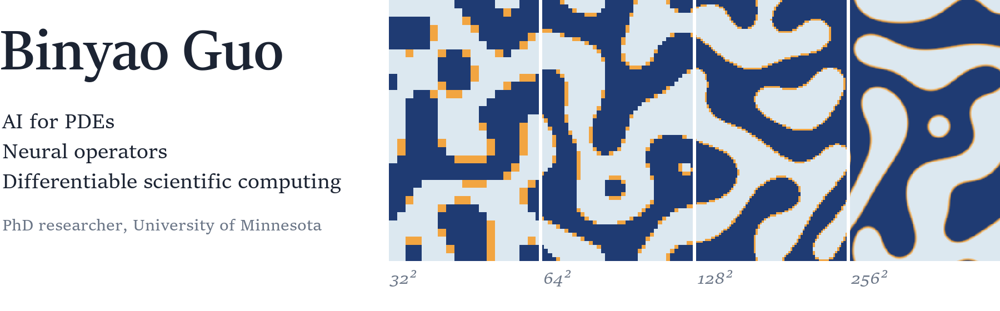
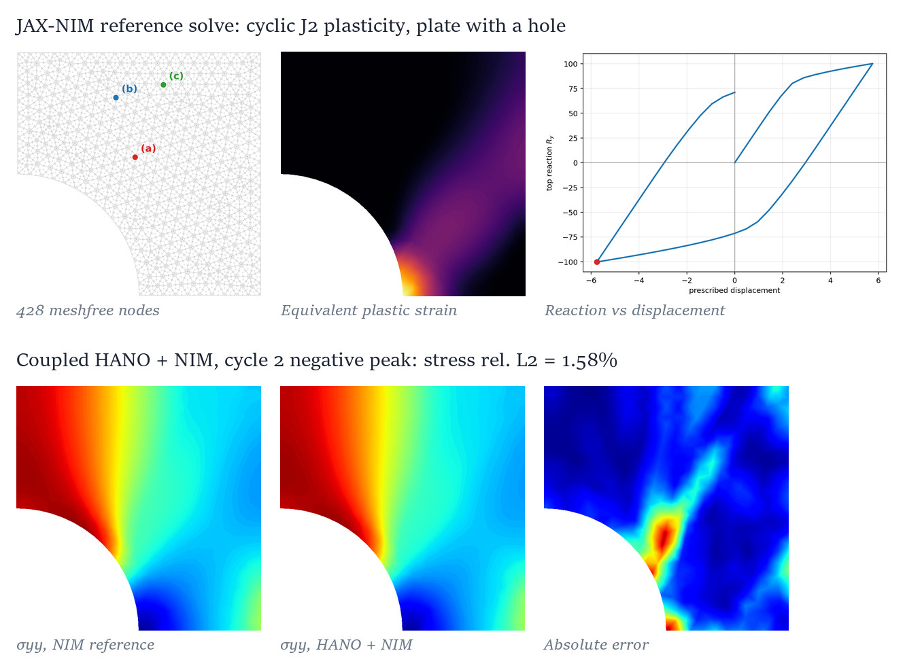
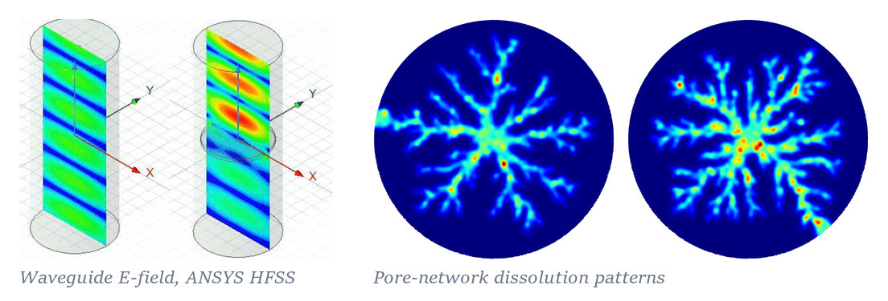
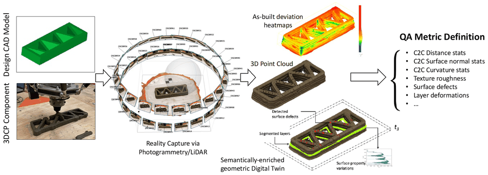
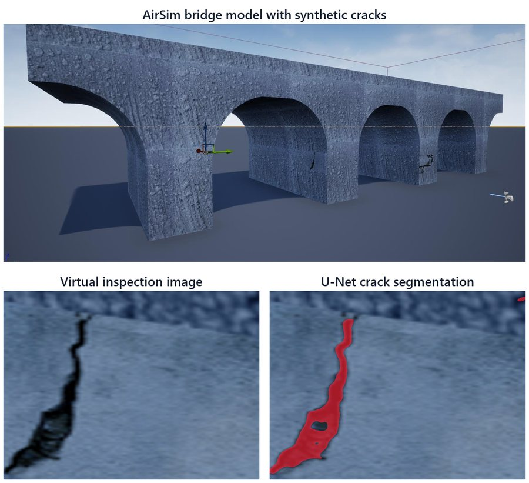

<picture>
  <source media="(prefers-color-scheme: dark)" srcset="assets/hero_dark.png">
  
</picture>

I am a PhD researcher at the University of Minnesota, advised by [Prof. QiZhi He](https://qzhe.umn.edu/) in the [Intelligent Mechanics Lab](https://github.com/IntelligentMechanicsLab). I develop neural operators, reduced-order models, and differentiable solvers for physical simulation, and I connect the learned models with numerical methods so they can be checked against PDE and mechanics benchmarks. Most of my work is in Python, JAX, and PyTorch. I am also interested in topology optimization, data-driven mechanics, physics-informed machine learning, and computer vision for physical environments.

I am also pursuing an M.S. in Computer Science at Minnesota. Before that I earned an M.S. at the University of Illinois Urbana-Champaign (2023) and a dual-degree B.Eng. from the University of Leeds and Southwest Jiaotong University (2021). I hold a UMN Data Science Initiative ADC Graduate Fellowship (2025).

Write to me at [guo00544@umn.edu](mailto:guo00544@umn.edu).

## Selected research

### SANO: resolution-free nonlinear model reduction

The Spectral Autoencoding Neural Operator is a nonlinear model-reduction method that is not tied to one grid: it compresses PDE fields by reducing their spectral degrees of freedom. Hierarchical Fourier-mode reduction, spectral resampling, and projected nonlinear layers remove the fixed-grid dependence of convolutional autoencoders and reduce aliasing. On Navier–Stokes, advection, Cahn–Hilliard, and Darcy fields, one trained model gives consistent outputs and latent codes on 32² to 256² grids. Extended to variational field generation and latent dynamics, it lowers the Wave-equation trajectory error from 0.4353 to 0.1914 (56%) against RONOM at matched latent dimension.

Top: Cahn–Hilliard rollout, ground truth and SANO. Bottom: a single latent code decoded on four grids.

### HANO: learning path-dependent materials from short histories

Recurrent material models are sensitive to the loading-step size and need a prescribed initial hidden state. The History-Aware Neural Operator avoids both by predicting stress from a short, observable strain–stress history, using an autoregressive U-Net, Fourier neural operator, and attention architecture trained with a decaying teacher-forcing schedule. In kinematic-hardening elastoplasticity it lowers the stress NRMSE from 2.3% to 0.6% against the best recurrent baseline. It was also evaluated on irregular histories, noisy data, and anisotropic damage.

First author, *Computer Methods in Applied Mechanics and Engineering* 447, 118358 (2025). [Paper](https://doi.org/10.1016/j.cma.2025.118358), [arXiv](https://arxiv.org/abs/2506.10352), [code](https://github.com/IntelligentMechanicsLab/HANO_inelasticity).

### Neural topology optimization with constrained optimization

A neural network represents the material density, and compliance is minimized under volume and binary-design constraints with principled constrained optimization (PyGRANSO). I worked on the constraint handling and extended the framework to multimaterial design.

R. Devera, **B. Guo**, B. Liang, Q. He, and J. Sun. Preprint, 2026; under review at *SIAM Journal on Scientific Computing*.

### JAX-NIM: a differentiable meshfree solver with a learned constitutive model

A local-support, sparse reproducing kernel particle method written in JAX. Element tangents are batched with `vmap`, essential boundary conditions are imposed through sparse KKT constraints, and the solve runs on the GPU in double precision. For a plate with a hole under cyclic J2 plasticity with kinematic hardening, the reference solve converges in all 50 load increments (428 nodes, 5,446 integration points, about 60 s). With HANO as the constitutive model inside the same Newton solve, the coupled stress field at the cycle-2 negative peak stays within 1.58% relative L2 of the reference. Part of an NSF project on differentiable solvers and neural constitutive models.

## Other PhD projects

- **Electromagnetic field surrogates.** A convolutional autoencoder with a frequency-to-latent regressor, trained on analytical waveguide solutions and ANSYS HFSS fields. With six latent variables the interpolation error is 1.86% for empty and 4.33% for dielectric-loaded waveguides. Manuscript in preparation.
- **DOE Genesis Mission: AI-guided critical mineral extraction.** PCA and autoencoder representations of pore-network dissolution and precipitation fields, with clustering and supervised models relating latent regimes, clogging labels, and reaction–transport parameters.
- **NSRI: generative learning for hypersonic flowfields.** A latent diffusion model trained to generate 2D hypersonic cylinder flowfields, as a learned prior for Bayesian inference from sparse observations.
- **HANO inside JAX-FEM (NSF).** Nonlinear equilibrium solves with Newton iterations, Jacobian-vector products, GMRES, and line search. In a single cyclic J2-plasticity test over 18 load increments, the final-state errors were 2.90% in stress, 1.05% in displacement, and 0.96% in reaction force.
- **Differentiable neural-integrated meshfree method.** Architecture variants, including CNN replacements for dense networks, for forward and inverse finite-strain hyperelasticity (second author, *Engineering with Computers*, 2025).

## Earlier work: computer vision and 3D geometry

At the University of Illinois Urbana-Champaign (2021–2023).

<table>
  <tr>
    <td width="50%" valign="top">
      <b>3D-printed concrete quality assessment from point clouds</b> 
       
      Photogrammetry and LiDAR point clouds are compared with the design geometry through distance, surface-normal, and curvature errors. Defects segmented in 2D images are back-projected onto the 3D model. M.S. thesis.
    </td>
    <td width="50%" valign="top">
      <b>UAV inspection planning in simulation</b> 
       
      A virtual UAV flies candidate paths in AirSim over a model with synthetic cracks. YOLO and U-Net find and segment the defects, structure-from-motion maps them to 3D, and path planning trades coverage against travel distance.
    </td>
  </tr>
</table>

<b>3D-printed concrete quality assessment: aims and methods</b>

 

Large-scale 3D concrete printing still lacks systematic quality control, and the consistency of layer dimensions during printing had not been studied closely. The thesis addresses three questions:

1. **Global shape.** How closely does the printed part match its intended geometry? The point cloud of the print is compared with the design shape using distance error, normal-angle difference, and curvature error.
2. **Surface defects.** Where are the defects? They are detected in 2D images, and the defect pixels are back-projected into 3D so they can be inspected and measured on the model.
3. **Layer consistency.** Is the print uniform? The uniformity and integrity of the part are evaluated from the consistency of its layer dimensions.

**B. Guo**, M.S. thesis, University of Illinois Urbana-Champaign, 2023.

<b>UAV inspection planning: case study</b>

 

A framework for planning automated robotic inspections by simulating different inspection scenarios and scoring their performance. In the case study, the goal is to choose the best UAV inspection path for a bridge:

1. A script adds cracks at random locations to the graphic model of the bridge.
2. The model is imported into AirSim, and a virtual UAV is programmed to fly each candidate path and capture images.
3. YOLO localizes the cracks in each image, and a U-Net segments them at pixel level.
4. Structure-from-motion maps the detected defects onto the 3D model.
5. Quantitative metrics computed on the mapped defects guide the optimization and planning of real inspections.

Related paper: publication 7 below.

## Publications

**Journal articles**

1. **B. Guo**, Z. Lin, and Q. He. History-Aware Neural Operator: Robust Data-Driven Constitutive Modeling of Path-Dependent Materials. *Computer Methods in Applied Mechanics and Engineering* 447, 118358, 2025. [Paper](https://doi.org/10.1016/j.cma.2025.118358), [arXiv](https://arxiv.org/abs/2506.10352), [code](https://github.com/IntelligentMechanicsLab/HANO_inelasticity)
2. H. Du, **B. Guo**, and Q. He. Differentiable Neural-Integrated Meshfree Method for Forward and Inverse Modeling of Finite Strain Hyperelasticity. *Engineering with Computers* 41, 1597–1617, 2025. [Paper](https://doi.org/10.1007/s00366-024-02090-z), [arXiv](https://arxiv.org/abs/2407.11183)

**Preprints and manuscripts**

3. H. Du, **B. Guo**, and Y. Pan. JAX-WAVE: A Differentiable Physics-Supervised Framework for Inverse Wave Design in Heterogeneous Media. arXiv:2611.13826, 2026. [arXiv](https://arxiv.org/abs/2611.13826)
4. R. Devera, **B. Guo**, B. Liang, Q. He, and J. Sun. Neural Topology Optimization with Principled Constrained Optimization. Preprint, 2026; under review at *SIAM Journal on Scientific Computing*.
5. **B. Guo** and Q. He. Spectral Autoencoding Neural Operator (SANO): Discretization-Consistent Nonlinear Reduced Representations of Scientific Fields. Manuscript in preparation.
6. S. Dietterich, **B. Guo**, S. Hanany, and Q. He. Advancing Data-Driven Electromagnetics Simulations with the Convolutional Auto-Encoder. Manuscript in preparation.

**Conference papers**

7. Y. Zhao, **B. Guo**, I. Aziz, and M. Alipour. An Optimization Framework for UAS-Based Infrastructure Inspection Path Planning. *Computing in Civil Engineering 2023*, 890–898, 2023. [Paper](https://doi.org/10.1061/9780784485248.107)
8. Y. Zhao, **B. Guo**, H. Che, and M. Alipour. Developing Human Sensing Platforms for Digitizing Visual Inspections of Critical Infrastructure. *Structures Congress 2023*, 340–353, 2023. [Paper](https://doi.org/10.1061/9780784484777.030)

**Thesis**

9. **B. Guo**. Quality Assessment of 3D Printed Concrete Through Point Cloud Data Analysis. M.S. thesis, University of Illinois Urbana-Champaign, 2023.

## Tools

**Programming and frameworks.** Python, JAX, PyTorch, MATLAB, automatic differentiation. 
**Numerical methods.** FEM, RKPM, Newton methods, JVP and GMRES, Fourier representations, PCA and POD, nonlinear mechanics, ANSYS HFSS, Abaqus. 
**Scientific machine learning.** Neural operators, autoencoders and VAEs, latent diffusion, Neural ODE surrogates, autoregressive training, cross-resolution evaluation.
