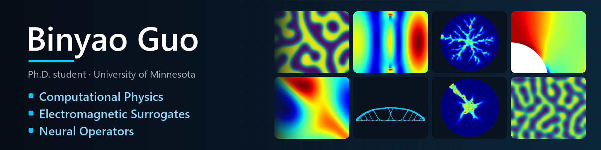
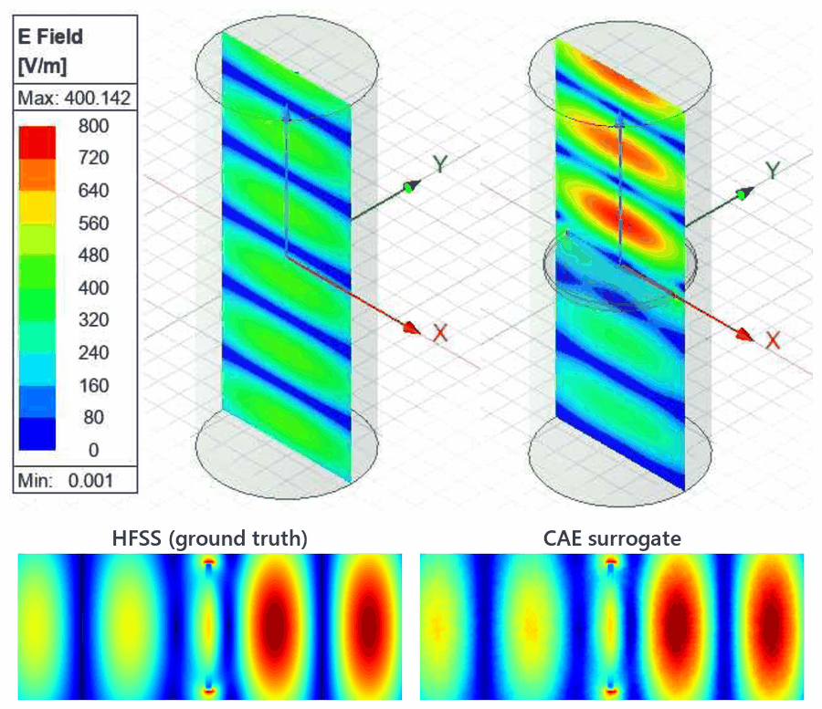
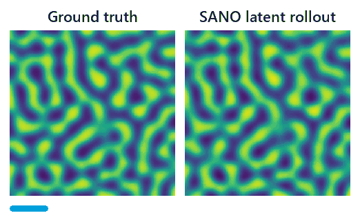
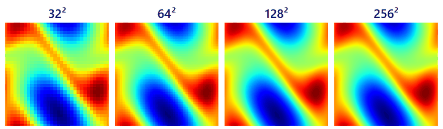
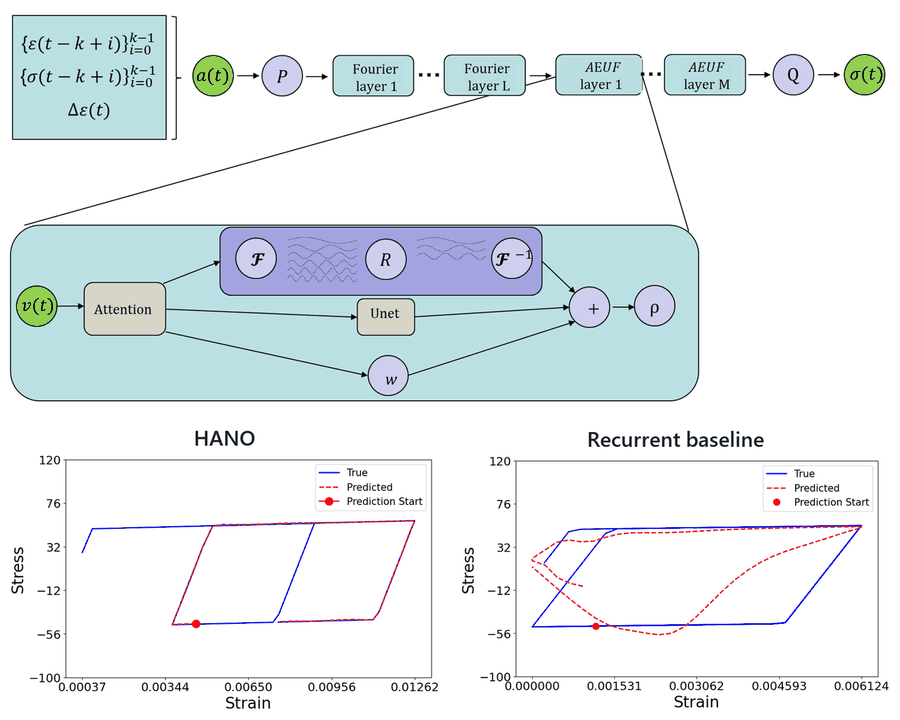
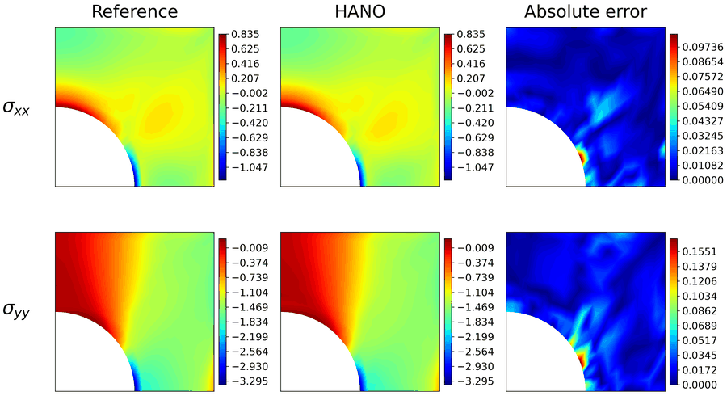
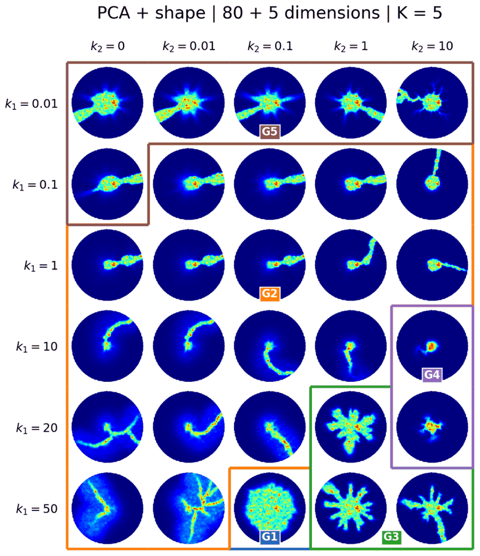
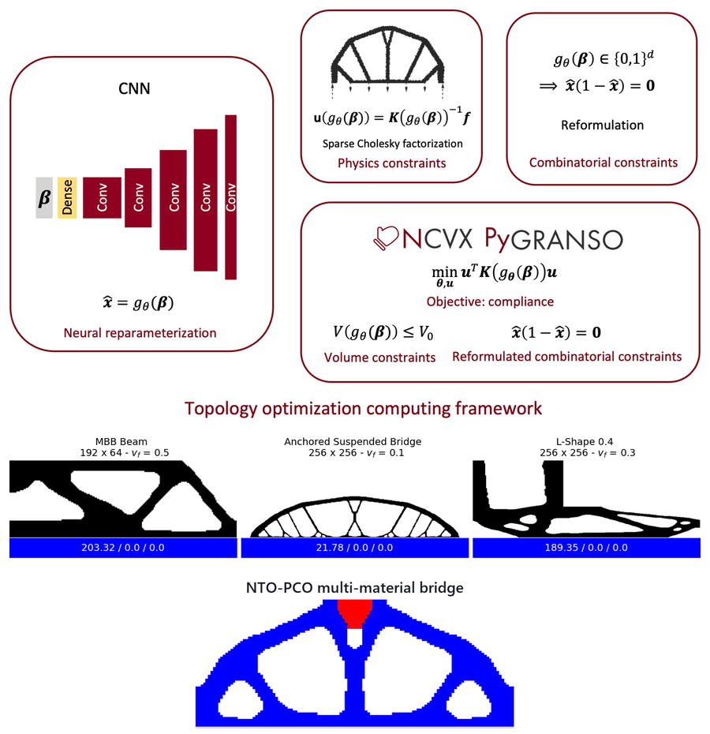

  

  

  
  
  
  

---

### 👋 About me

- 🎓 **Ph.D. student in Civil Engineering** at the **University of Minnesota** (advisor: Prof. QiZhi He), also pursuing an **M.S. in Computer Science** at UMN.
- 🧠 I build **neural operators and latent surrogates** for physical simulation, from path-dependent plasticity to electromagnetic waveguides and phase-field PDEs.
- 🔧 I couple learned models with **differentiable solvers** (JAX-FEM, RKPM, neural-integrated meshfree) so they can run inside real simulations.
- 🏫 Previously: M.S. Structural Engineering @ **UIUC**; B.Eng. Civil Engineering (dual degree) @ **University of Leeds** (First-Class) & **Southwest Jiaotong University**.
- 🏆 UMN Data Science Initiative ADC Graduate Fellowship (2025) · DOE Genesis Mission Hackathon @ Argonne National Laboratory (2026).

---

### 🔬 Research highlights

<table>
  <tr>
    <td width="50%" valign="top">
      <h4>⚡ Electromagnetic Waveguide Surrogate</h4>
      
      Convolutional autoencoder + frequency→latent mapper trained on <b>ANSYS HFSS</b> field data. With only <b>6 latent variables</b>, interpolation error is <b>1.86%</b> (empty) and <b>4.33%</b> (dielectric-loaded) for cylindrical waveguides.
    </td>
    <td width="50%" valign="top">
      <h4>🌊 SANO: Spectral Autoencoding Neural Operator</h4>
      
      
      Discretization-consistent nonlinear reduced representations. <b>Top:</b> autoregressive Cahn–Hilliard rollout in latent space. <b>Bottom:</b> one latent code decoded zero-shot on <b>32²–256²</b> grids. Wave-equation trajectory error <b>0.4353 → 0.1914</b> vs. RONOM.
    </td>
  </tr>
  <tr>
    <td width="50%" valign="top">
      <h4>🧱 HANO: History-Aware Neural Operator</h4>
      
      Autoregressive U-Net + Fourier neural operator + attention for path-dependent plasticity. Starting predictions mid-history (red dot), HANO tracks the hysteresis loop while a recurrent baseline drifts. Stress NRMSE <b>2.3% → 0.6%</b>. First author, <i>CMAME</i> 2025 · <a href="https://github.com/IntelligentMechanicsLab/HANO_inelasticity">code</a>.
    </td>
    <td width="50%" valign="top">
      <h4>🔁 Learned Plasticity inside JAX-FEM</h4>
      
      HANO embedded as the constitutive model in nonlinear <b>JAX-FEM</b> solves (Newton, Jacobian-vector products, GMRES, line search). Shown: plate-with-hole stresses. In a cyclic J2-plasticity test it converged over <b>18 load increments</b> with final errors of <b>2.90%</b> stress, <b>1.05%</b> displacement, and <b>0.96%</b> reaction force. <i>(NSF project)</i>
    </td>
  </tr>
  <tr>
    <td width="50%" valign="top">
      <h4>🪨 DOE Genesis: Pore-Network Dissolution</h4>
      
      AI-guided critical-mineral extraction. 80 PCA coefficients + 5 morphology features with K-means (<b>K = 5</b>) organize <b>1,881</b> dissolution simulations into pattern families, from compact and uniform dissolution to wormholes and ramified branches.
    </td>
    <td width="50%" valign="top">
      <h4>🏗️ Neural Topology Optimization (NTO-PCO)</h4>
      
      CNN reparameterization of the design field, solved with principled constrained optimization (<b>PyGRANSO</b>) under physics, volume, and combinatorial constraints. Extends to <b>multi-material</b> designs. Co-author.
    </td>
  </tr>
</table>

<b>More projects</b>

 

- 🕸️ **Differentiable Neural-Integrated Meshfree (NIM)** method for finite-strain hyperelasticity, forward and inverse (2nd author, <i>Engineering with Computers</i> 2025).
- 🧮 **Differentiable RKPM solver** in JAX, developed alongside the HANO coupling work.
- 🚀 **NSRI: generative Bayesian learning for hypersonic flowfields.** A latent diffusion model generates 2D hypersonic cylinder flowfields as a learned prior for sparse-observation inference.
- 🏢 **UIUC:** point-cloud quality assessment for 3D-printed concrete; U-Net crack segmentation + structure-from-motion for 2D-to-3D crack localization.

---

### 📄 Selected publications

- **B. Guo**, Z. Lin, Q. He. *History-Aware Neural Operator: Robust Data-Driven Constitutive Modeling of Path-Dependent Materials.* **Computer Methods in Applied Mechanics and Engineering** 447 (2025). [[DOI]](https://doi.org/10.1016/j.cma.2025.118358) [[arXiv]](https://arxiv.org/abs/2506.10352) [[code]](https://github.com/IntelligentMechanicsLab/HANO_inelasticity)
- H. Du, **B. Guo**, Q. He. *Differentiable Neural-Integrated Meshfree Method for Forward and Inverse Modeling of Finite Strain Hyperelasticity.* **Engineering with Computers** 41, 1597–1617 (2025). [[DOI]](https://doi.org/10.1007/s00366-024-02090-z) [[arXiv]](https://arxiv.org/abs/2407.11183)
- **B. Guo**, Q. He. *Spectral Autoencoding Neural Operator (SANO): Discretization-Consistent Nonlinear Reduced Representations of Scientific Fields.* Manuscript.
- R. Devera, **B. Guo**, B. Liang, Q. He, J. Sun. *Neural Topology Optimization with Principled Constrained Optimization.* Manuscript.
- S. Dietterich, **B. Guo**, S. Hanany, Q. He. *Advancing Data-Driven Electromagnetics Simulations with the Convolutional Auto-Encoder.* In preparation.
- Y. Zhao, **B. Guo**, I. Aziz, M. Alipour. *An Optimization Framework for UAS-Based Infrastructure Inspection Path Planning.* **Computing in Civil Engineering 2023**, 890–898.
- Y. Zhao, **B. Guo**, H. Che, M. Alipour. *Developing Human Sensing Platforms for Digitizing Visual Inspections of Critical Infrastructure.* **Structures Congress 2023**, 340–353.

---

### 🛠️ Toolbox

  
  
  
  
  
  
  

